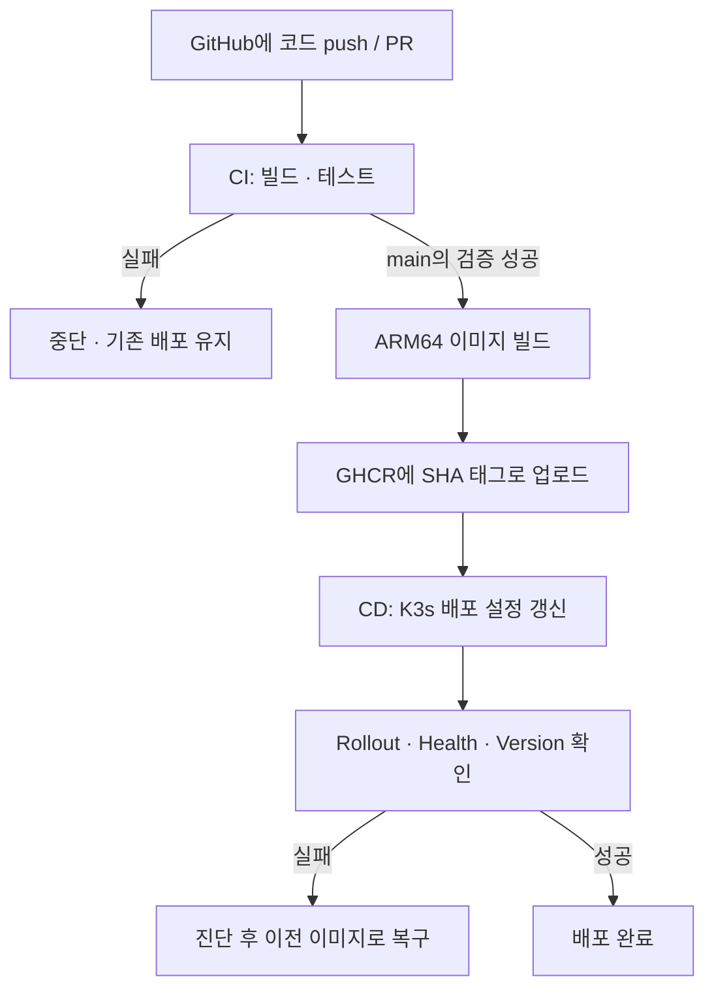

# 다음 학습 시작점

최종 갱신 2026-11-25. 체크되지 않은 작업은 구현·실습 완료로 간주하지 않는다.

## 최근 실습과 다음 단계

- [x] Cloud Build로 데모 이미지를 Artifact Registry에 푸시하고 Cloud Run 자동 배포 확인.
- [x] 로컬 브라우저에서 인증 호출, 요청 ID 추적, 리비전 50:50 분할과 최신 리비전 100% 복원.
- [x] `/slow` 동시 요청으로 인스턴스 1 → 2 확인. 부하 종료 후 활성 0개·유휴 2개 관측.
- [x] Cloud Monitoring 대시보드에서 테스트 리비전의 유휴 인스턴스도 0개로 줄어 전체 0개가 된 것을 확인.
- [x] 인스턴스 0개 상태에서 새 요청을 보내 콜드 스타트와 HTTP 200 응답 확인.
- [ ] Cloud Build에서 테스트 실패 시 배포가 중단되는지 검증.

[Cloud Run 실습 기록과 PowerShell 조회 명령](docs/learning-notes/infra/09-cloud-run-lab.md)을 먼저 확인한다.

## GHCR → K3s 계획 재개 지점

**단계 R1 진행 전. 사용자에게 아래 명령 결과를 요청한 상태이며, 아직 결과를 받지 않았다.**

Mac 터미널에서:

```sh
docker image ls backend-infra-testing
```

Ubuntu 셸이면 `exit`로 Mac으로 나온 뒤 실행한다.
`backend-infra-testing:version-v2`가 있는지 확인하고, 없으면 Docker 실행 상태와 빌드부터 복구한다.
그다음 R2의 GHCR 인증·공개 범위를 사용자와 확인한다. 로그인·push가 완료됐다고 가정하지 않는다.

## 학습 진행 방식 — 다음 에이전트도 유지

- 사용자는 백엔드·인프라 초보이며 **직접 한 단계씩 실행하고 결과를 보내는 방식**을 원한다.
- 한 번에 개념 하나와 관련 명령 1~2개만 설명하고, 출력을 확인한 뒤 다음 단계로 간다.
- 명령을 실행할 곳을 반드시 `Mac 터미널`, `Ubuntu 셸`, `GitHub 웹`으로 구분한다.
- 개념 관계는 큰 구조부터 간단한 Mermaid로 설명한다. 세부 요소를 한 그림에 과하게 넣지 않는다.
- 사용자의 설명이 대체로 맞으면 먼저 핵심을 인정하고 필요한 차이만 바로잡는다.
- 사용자가 직접 실습하는 단계에서 에이전트가 모든 설치·배포를 대신 완료하지 않는다.
  사용자가 자동 실행을 요청하면 그 요청을 따른다.
- 실습마다 이 문서의 체크박스·현재 단계·확인 결과를 갱신한다.
- 문서화·커밋·푸시는 사용자가 요청했을 때 수행한다. 토큰이나 Secret 값은 문서·채팅·커밋에 남기지 않는다.

## 이미 완료한 학습

- [x] Linux 셸·파일·프로세스, 셸 종료와 앱 종료의 차이.
- [x] Cluster·Control Plane·Scheduler·Node·Pod·Container 관계.
- [x] Namespace와 `-n`, 조회·watch·describe·logs.
- [x] Deployment·ReplicaSet·replicas, Pod 삭제 후 자동 재생성.
- [x] Service·Selector·Label·EndpointSlice, Pod 교체 후 IP 갱신.
- [x] Startup·Readiness·Liveness, DB 중단 시 트래픽 제외·재시작 없이 복구.
- [x] PVC·PV·local-path, 영속 저장과 백업의 차이.
- [x] ConfigMap·Secret 개념. 현재 K3s 일반 설정은 직접 env, 비밀번호만 Secret.
- [x] Ingress 규칙과 Traefik Controller 구분, Host·Path, 리버스 프록시.
- [x] Cloudflare Tunnel 공개. Tailscale은 개념만 비교했고 설치하지 않음.
- [x] Rolling Update·배포 이력·롤백, 새 Pod Ready 후 기존 Pod 종료 관찰.
- [x] Requests·Limits·HPA, CPU 부하로 Pod 및 Endpoint 1→3→1 확인.
- [x] 실제 `/version` 추가, 새 이미지 배포와 이전 이미지 롤백 후 v2 복원.
- [x] CI 실패는 배포 중단, CD 실패는 별도 정책 필요, 자동 롤백은 자동 제공되지 않는다는 개념 설명.

상세 기록: [전체 실습](docs/learning-notes/infra/08-macos-k3s-lab.md),
[배포·롤백](docs/learning-notes/infra/07-image-deploy-rollback.md),
[큰 구조도](docs/learning-notes/infra/06-kubernetes-big-picture.md).
기존 코드·실습 문서를 포함한 마지막 기준 커밋은 `a4b1d78`이다. 이후 커밋이 있으면 저장소 상태를 우선한다.

## 환경과 마지막 확인 상태

| 항목 | 값 |
|---|---|
| 저장소 | `https://github.com/killerkoje/backend_infra_testing`, `main` |
| Mac 프로젝트 | `/Users/leeheewon/Documents/side-projects/backend_infra_testing` |
| Node.js | 프로젝트는 Node 22. Mac에서는 `/opt/homebrew/opt/node@22/bin` 사용 |
| Linux VM | Lima `backend-k3s`, Ubuntu 24.04 ARM64, CPU 4개·4GiB·디스크 30GiB |
| 서버 접속 | `/opt/homebrew/bin/limactl shell backend-k3s` |
| K3s Node | `lima-backend-k3s`, 단일 노드, 관리와 앱 실행 겸임 |
| Namespace | `backend-learning` |
| 백엔드 | Deployment `backend`, Container `backend` |
| 현재 이미지 | `backend-infra-testing:version-v2`, `imagePullPolicy: Never` |
| 현재 응답 | `/version` → `{"version":"v2"}`, `/health/ready` → `{"status":"ready"}` |
| DB | Deployment `postgres`, Service `postgres-service`, DB `study` |
| 저장소 | PVC `postgres-data`, 1Gi, local-path |
| HPA | `backend`, CPU 50%, min 1 / max 3, 마지막 확인 replicas 1 |
| Ingress | `backend`, class `traefik`, Host 미지정, `/` Prefix → backend-service:3000 |
| 로컬 진입점 | Mac `http://127.0.0.1:8082` → VM 80 |
| 레지스트리 계획 | `ghcr.io/killerkoje/backend-infra-testing` — 아직 업로드 확인 안 됨 |
| CI/CD | 저장소 확인 시 `.github/workflows` 없음. 아직 구현 안 됨 |

위 값은 마지막 확인 기록이지 현재 실행 상태 보장이 아니다. Pod 이름·IP·revision은 고정하지 않는다.
Cloudflare 임시 URL과 PID는 재실행하면 달라질 수 있으므로 옛 값을 그대로 사용하지 않는다.
VM과 Docker Desktop은 별개이며 둘 다 Mac 종료·절전의 영향을 받는다.

환경이 꺼졌다면 [시작·종료 문서](infra/local-server/README.md)를 참고한다.
Mac에서 VM 상태를 확인하고, 실행 중일 때 Ubuntu에서 Pod·HPA·이미지부터 재확인한다.

```sh
# Mac
/opt/homebrew/bin/limactl list

# Ubuntu
sudo k3s kubectl -n backend-learning get pods,hpa
sudo k3s kubectl -n backend-learning get deployment backend -o jsonpath='{.spec.template.spec.containers[0].image}'
```

## 목표 흐름



이 그림은 최종 목표다. 처음에는 수동 push·수동 배포를 성공시킨 뒤 각 부분을 자동화한다.
로컬 commit만으로 GitHub Actions가 실행되지는 않는다. push·PR·수동 실행 등 트리거를 설정해야 한다.

## 단계별 계획과 완료 기준

### R1. 로컬 이미지와 주소 이해

- [ ] Mac에서 `docker image ls backend-infra-testing` 결과 확인.
- [ ] registry / owner / image / tag를 사용자 말로 설명.
- [ ] 로컬 이미지가 없으면 기존 Dockerfile로 `version-v2` 빌드.

목표 주소: `ghcr.io/killerkoje/backend-infra-testing:version-v2`.
Git 저장소는 소스 코드, 레지스트리는 빌드된 이미지를 보관한다.
완료 기준: 대상 이미지가 있고, tag를 붙이는 것이 이미지 재빌드와 다름을 이해.

### R2. GHCR 인증과 이미지 접근 범위

- [ ] GitHub 계정의 패키지 업로드 권한 확인.
- [ ] 이미지 공개 여부를 사용자와 결정. 처음 push된 패키지는 기본 private이며 저장소 공개 여부와 별개.
- [ ] Mac의 수동 로그인에 필요한 PAT classic을 최소 범위로 준비하고 직접 입력.
- [ ] `docker login ghcr.io -u killerkoje` 등으로 인증, `Login Succeeded` 확인.
- [ ] 토큰을 받거나 출력하지 않고 로그인 성공 여부만 기록.

수동 upload에는 `write:packages`, private download에는 `read:packages` 권한을 확인한다.
이후 GitHub Actions 업로드는 가능하면 PAT 대신 워크플로의 `GITHUB_TOKEN`을 사용한다.
완료 기준: 인증 성공과 public/private 선택 기록. 실제 토큰은 기록하지 않는다.

### R3. 수동 tag·push·레지스트리 확인

- [ ] 소스 저장소 연결용 OCI source label을 빌드에 추가. 이후 Actions의 패키지 권한도 확인.
- [ ] `docker tag`로 로컬 이미지를 GHCR 이름으로 지정.
- [ ] `docker push` 성공 및 digest 기록.
- [ ] GitHub Packages 화면에서 이미지·태그·저장소 연결·공개 범위 확인.
- [ ] 이미지가 `linux/arm64`를 지원하는지 확인.

완료 기준: GHCR에 `version-v2`가 실제 존재. 토큰 없는 public pull 또는 private 인증 pull 경로가 결정됨.
공개 여부는 코드 저장소와 별개이며, 승인 없이 public으로 바꾸지 않는다.

### R4. K3s가 GHCR에서 직접 내려받아 배포

- [ ] 변경 전 현재 이미지·revision·정상 응답 기록.
- [ ] private 이미지라면 `backend-learning`에 pull 전용 Secret 생성 및 `imagePullSecrets` 연결.
- [ ] 이미지 참조를 GHCR 주소로 변경하면서 **`imagePullPolicy: Never`도 함께 변경**.
- [ ] 새 버전 태그 또는 digest를 사용하고 `IfNotPresent` 등 pull 정책의 동작 확인.
- [ ] 서버 dry-run 후 적용, rollout 완료와 Pod Events의 pull 결과 확인.
- [ ] `/version`, `/health/ready`, DB·HPA가 유지되는지 확인.
- [ ] 저장소의 선언 파일도 실제 배포와 일치하도록 갱신.

완료 기준: TAR 복사·ctr import 없이 K3s에서 GHCR 이미지를 실행.
기존 로컬 이미지와 GHCR 전체 주소는 다르다. 로컬 캐시만으로 성공한 것을 원격 pull 성공으로 오해하지 않는다.
실패 시 Events에서 인증 오류·없는 태그·아키텍처 불일치를 구분하고 원인을 해결한다.

### C1. GitHub Actions로 CI만 만들기

- [ ] workflow·trigger·job·step·runner 개념 설명.
- [ ] GitHub-hosted runner, Node 22, `npm ci`, 빌드 검사 구성.
- [ ] `/version` 등 의미 있는 동작 검증 추가. 단순 빌드 성공을 테스트 완료로 부르지 않음.
- [ ] DB가 필요한 테스트는 별도 PostgreSQL 서비스와 마이그레이션을 사용. 운영·학습 DB와 분리.
- [ ] PR과 main push에서 CI 수행, 배포는 아직 하지 않음.
- [ ] 실습 브랜치에서 의도적 실패를 만들어 실패 로그·배포 미발생 확인 후 수정.

완료 기준: 성공·실패 CI를 모두 관찰하고 기존 서비스가 영향을 받지 않음.

### C2. CI 성공 후 이미지 빌드·GHCR 업로드 자동화

- [ ] main push와 필요한 수동 실행에서만 publish. PR에서는 검사만 수행.
- [ ] `contents: read`, `packages: write` 등 필요한 권한만 부여하고 `GITHUB_TOKEN` 인증.
- [ ] Docker buildx로 `linux/arm64` 이미지 생성. 필요하면 amd64+arm64로 확장.
- [ ] `sha-<commit>` 같은 버전별 태그, 소스 revision label, digest 기록.
- [ ] Actions의 이미지가 해당 commit과 연결되는지 확인.
- [ ] 처음에는 배포를 수동으로 해서 CI 산출물이 실제 K3s에서 동작하는지 검증.

완료 기준: 소스 push → CI → 새 GHCR 이미지 생성 → 수동 K3s 배포 성공.
기존 `/version`은 고정 문자열 v2이므로 이 단계에서 commit 기반 버전 표시도 설계한다.

### D1. 원격 CI와 집의 K3s 사이 연결 방식 학습

- [ ] GitHub-hosted runner는 집의 VM 내부 IP에 직접 접속할 수 없음을 이해.
- [ ] 현재 Cloudflare 터널은 웹 API 공개용이며 Kubernetes API/SSH 배포 통로가 아님을 확인.
- [ ] 저장소 public/private 상태를 확인하고 배포 경로를 선택해 결정 근거 기록.
- [ ] 기본 제안: CI는 GitHub-hosted, CD는 VM 안에서 Git을 읽는 pull 방식 GitOps.
- [ ] Flux 등 GitOps 도구의 역할을 먼저 설명하고 수동 배포가 끝난 후 도입.

다른 선택지는 제한된 네트워크 연결을 통한 push 배포지만, 별도 접속·인증 설계가 필요하다.
공개 저장소의 PR 코드를 개인 Mac의 self-hosted runner에서 실행하지 않는다.
완료 기준: 누가 어디서 무엇을 실행하는지 사용자가 설명하고 배포 방식을 확정.

### D2. CD 구성과 실패 복구

- [ ] CI가 검증한 이미지 tag/digest만 배포 설정에 반영.
- [ ] 처음에는 수동 배포 트리거 또는 배포 설정 PR로 변경을 검토 가능하게 구성.
- [ ] 선택한 방식으로 K3s에 적용하고 rollout timeout·health·version 검증.
- [ ] HPA가 관리하는 replicas와 선언 파일의 관계 정리. 배포 때마다 1개로 덮어쓰지 않도록 처리.
- [ ] registry 인증 정보·배포 권한은 필요한 범위만 제공.
- [ ] 동시 배포 방지와 이전 정상 이미지/digest 기록.
- [ ] 잘못된 이미지나 기동 실패를 통제된 실습으로 재현하고 진단·복구 확인.

실패 정책:

| 실패 위치 | 기본 동작 |
|---|---|
| CI 빌드·테스트 | 중단. 이미지 배포 안 함 |
| 이미지 업로드 | 중단. 기존 이미지로 서비스 유지 |
| 새 Pod 기동·Readiness | 배포 실패를 탐지하고 Events·로그 확인. 기존 Pod 유지 여부도 확인 |
| HTTP·version 검증 | 앱 장애와 라우팅 문제를 구분 후 이전 정상 이미지로 복구 |

Kubernetes는 rollout 실패 시 이전 Deployment 설정으로 자동 undo하지 않는다.
처음에는 수동 복구를 익히고, 자동 롤백은 그다음 별도 정책으로 구현한다.
GitOps에서는 live 상태만 undo하면 다시 덮어쓸 수 있으므로 Git의 배포 설정도 이전 이미지로 되돌린다.
DB migration은 이미지 rollback으로 복구되지 않는다. 이 과정에서 DB 파괴적 변경은 함께 실험하지 않는다.

완료 기준: 코드 push부터 새 버전 검증까지 성공하고, 실패 시 복구 경로를 실제 확인.

### F1. 이후 학습

- [ ] PostgreSQL 백업·별도 DB 복원으로 데이터 검증.
- [ ] 구조화 로그·메트릭·대시보드·알림.
- [ ] 고정 도메인·접근 제어·별도 서버 배포가 필요하면 추가 설계.

## 세션 종료 시 갱신할 진행 기록

| 항목 | 현재 기록 |
|---|---|
| 마지막 완료 단계 | 로컬 v2 이미지 수동 전달·배포·롤백 실습 |
| 다음 진행 단계 | R1: Mac의 로컬 이미지 조회 결과 확인 |
| GHCR 접근 범위 | 미정 |
| GHCR 로그인·push | 미확인 / 미완료 |
| 원격 이미지 tag·digest | 없음 |
| CI workflow | 없음 |
| CD 방식 | 미정. pull GitOps 제안 단계 |
| 최근 실습 장애 | 없음. 실행 상태는 다음 세션에 재확인 |

단계 완료 시 체크박스를 표시하고 여기에 실행 결과·commit·tag/digest·다음 명령을 남긴다.
아직 하지 않은 작업을 완료로 표시하지 않는다.

## 참고 문서

- [GitHub Container Registry 인증·접근 범위·push·소스 연결](https://docs.github.com/en/packages/working-with-a-github-packages-registry/working-with-the-container-registry)
- [Docker GitHub Actions 멀티플랫폼 이미지](https://docs.docker.com/build/ci/github-actions/multi-platform/)
- [GitHub Actions 보안·self-hosted runner 주의점](https://docs.github.com/en/actions/reference/security/secure-use)

2026-11-16 계획 작성 시 공식 문서를 확인했다. 실제 구현 단계에서는 액션 버전과 권한·인증 방식을 다시 확인한다.
