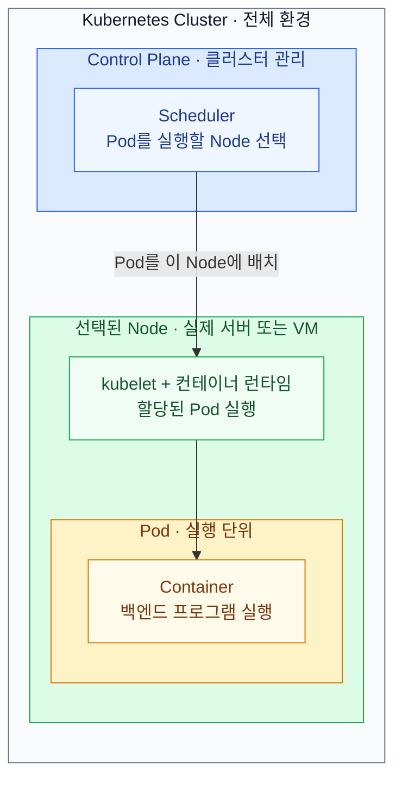

# Kubernetes — 전체 숲 보기

**Cluster가 전체 환경이고, 그 안에 Node들이 있다.**
Control Plane의 Scheduler가 Pod를 실행할 Node를 고른다.

- **포함 관계:** Cluster → Node → Pod → Container.
- **관리 흐름:** Control Plane 안의 Scheduler가 Node 선택 → 해당 Node에서 Pod 실행.
- **현재 네 환경:** Ubuntu VM 한 대가 Control Plane 역할과 앱 실행 역할을 모두 맡는다.

그림은 관리와 실행 역할을 구분한 것이다. Scheduler의 배치 결정은 API Server를 통해 전달되며, 실제 실행은 Node가 담당한다.
