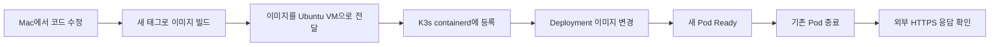

# 새 이미지 배포와 롤백 실습

## 이번 변경

기존 `graceful-v1`에는 `/version`이 없어서 HTTP 404가 나온다.
새 `version-v2`는 `GET /version`에 `{"version":"v2"}`를 응답한다.



## Mac 터미널에서 실행

저장소 루트에서 실행한다. 같은 태그를 덮어쓰지 않고 버전마다 새 태그를 사용한다.

```sh
docker build -t backend-infra-testing:version-v2 .
docker image save --platform linux/arm64 -o /private/tmp/backend-version-v2.tar backend-infra-testing:version-v2
/opt/homebrew/bin/limactl cp /private/tmp/backend-version-v2.tar backend-k3s:/tmp/backend-version-v2.tar
/opt/homebrew/bin/limactl shell backend-k3s sudo k3s ctr images import /tmp/backend-version-v2.tar
```

Docker Desktop의 이미지 저장소와 K3s의 containerd 저장소는 별개다.
현재 `imagePullPolicy: Never`이므로 K3s에 이미지를 먼저 전달해야 한다.
전달하지 않으면 새 Pod가 이미지를 찾지 못해 시작하지 못한다.

## Ubuntu 셸에서 실행

Mac에서 `/opt/homebrew/bin/limactl shell backend-k3s`로 접속한다.

```sh
# 현재 이미지 및 배포 이력을 먼저 기록
sudo k3s kubectl -n backend-learning get deployment backend -o jsonpath='{.spec.template.spec.containers[0].image}'
sudo k3s kubectl -n backend-learning rollout history deployment/backend

# 새 이미지로 변경
sudo k3s kubectl -n backend-learning set image deployment/backend backend=backend-infra-testing:version-v2
sudo k3s kubectl -n backend-learning rollout status deployment/backend
```

`rollout restart`는 현재 이미지로 Pod를 교체한다.
`set image`는 Deployment의 이미지 참조를 바꿔 새 코드가 담긴 Pod로 교체한다.
HPA의 최소·최대 개수와 DB 데이터는 이 작업으로 변경되지 않는다.

## 외부 응답 확인

```sh
curl "https://<현재-터널-주소>/version"
```

예상 응답: `{"version":"v2"}`. 임시 터널을 다시 만들었다면 새 주소를 사용한다.

## 이전 이미지로 롤백

```sh
sudo k3s kubectl -n backend-learning rollout undo deployment/backend
sudo k3s kubectl -n backend-learning rollout status deployment/backend
```

롤백 직전이 `graceful-v1`이었다면 `/version`은 다시 HTTP 404가 된다.
`/health/ready`는 계속 HTTP 200이어야 한다. API가 없는 것과 서버 장애는 다르다.
이 명령은 배포 설정을 되돌리며, Mac 소스 코드나 DB 마이그레이션을 되돌리지 않는다.

다시 v2로 배포하려면 동일한 `set image ...version-v2` 명령을 실행한다.
이후 `infra/local-server/app.yaml`을 적용해도 같은 v2 이미지가 선택되도록 선언 파일도 맞췄다.

## 실제 검증 결과 (2026-11-15)

| 단계 | 이미지 | `/version` | `/health/ready` |
|---|---|---|---|
| 배포 전 | graceful-v1 | 404 | 200 |
| 새 이미지 배포 | version-v2 | 200, v2 응답 | 200 |
| 이전 revision으로 롤백 | graceful-v1 | 404 | 200 |
| 최종 복원 | version-v2 | 200, v2 응답 | 200 |

이번 실습은 revision 4 → 5(v2) → 6(롤백) → 7(v2 복원) 순서였다.
이전 ReplicaSet을 재사용하면 기존 revision 번호가 최신 번호로 갱신될 수 있다.
`CHANGE-CAUSE <none>`은 변경 사유를 별도로 기록하지 않았다는 뜻이다.
