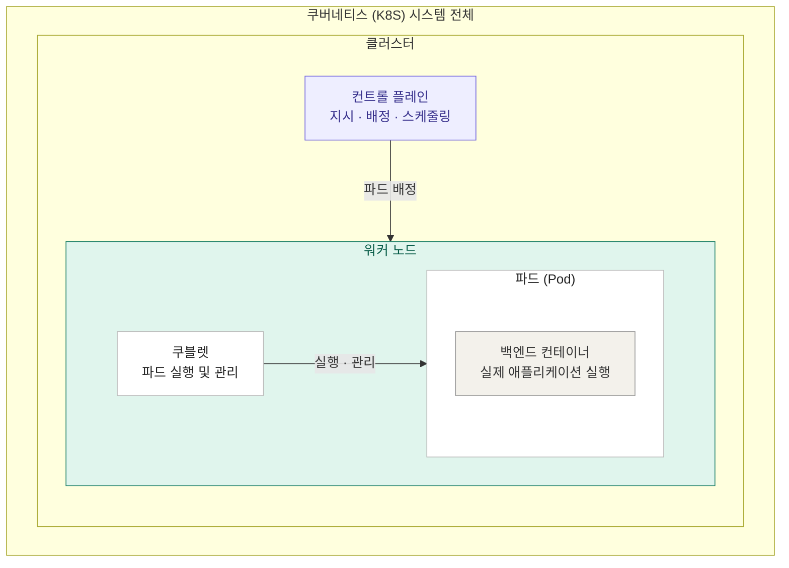

# Kubernetes 구조

## 구성 요소

| 구성 요소 | 역할 |
| --- | --- |
| 클러스터 (Cluster) | 여러 노드를 하나로 묶어 관리하는 K8S 환경 |
| 컨트롤 플레인 (Control Plane) | 파드 배치 결정, 상태 관리, 스케줄링 |
| 워커 노드 (Worker Node) | 실제 애플리케이션이 실행되는 서버 |
| 쿠블렛 (Kubelet) | 노드에서 파드가 정상 실행되도록 관리 |
| 파드 (Pod) | 컨테이너를 실행하는 K8S의 최소 배포 단위 |
| 컨테이너 (Container) | FastAPI, Spring Boot 등 실제 백엔드 실행 환경 |
