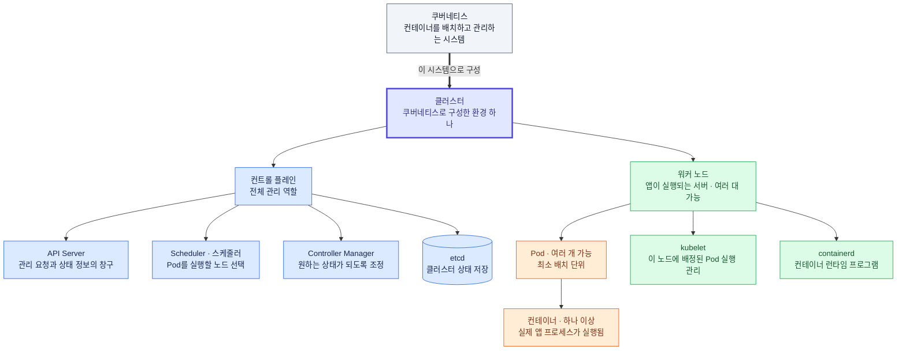
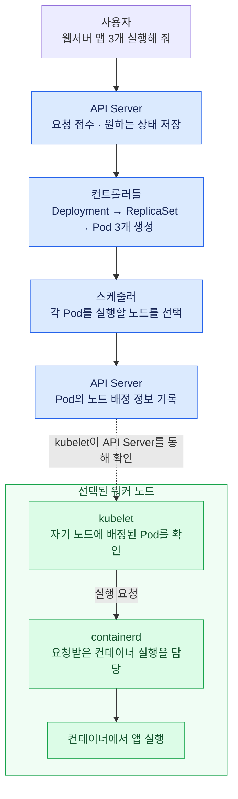

# 쿠버네티스 구조 총정리

## 1. 무엇 안에 무엇이 있나?

**쿠버네티스는 관리 시스템의 이름이고, 클러스터는 그 시스템으로 구성한 환경 하나다.**

> 위 그림의 가는 선은 **구성·포함 관계**다. 명령 전달 순서가 아니다. 컨트롤 플레인도 실제로는 노드 위에서 실행되지만, 그림에서는 역할을 나눴다.

## 2. 그러면 실제로 어떻게 실행하나?

> 이해를 위한 요약 흐름이다. 컨트롤러와 스케줄러는 API Server를 통해 상태를 확인하고 변경한다. 컨트롤러가 스케줄러를 직접 호출하는 것은 아니다. containerd 내부의 세부 실행 단계는 생략했다.

## 3. 지금까지 이해한 내용 확인

- **스케줄러가 Pod의 자리를 고른다** → 맞음. CPU·메모리 요청량과 배치 조건 등을 보고 노드를 선택한다.
- **Pod가 워커 노드에서 돌아간다** → 맞음. 한 노드에 여러 Pod를 배치할 수 있고, 하나의 Pod는 한 노드에서 실행된다.
- **Pod는 최소 작업 단위다** → 정확히는 **최소 배치 단위**다. 일회성 작업뿐 아니라 계속 실행하는 웹서버도 Pod로 실행한다.
- **containerd 안에 컨테이너가 들어 있다** → 공간으로 포함되는 관계보다 **containerd가 컨테이너를 실행·관리한다**고 이해하면 정확하다. containerd는 Pod와 컨테이너 사이의 포함 계층이 아니다.
- **Job과 Pod는 같다** → 다르다. `Job`은 완료가 필요한 작업을 관리하는 리소스이고, 그 작업을 수행하는 Pod를 만든다. 스케줄러가 배치하는 대상은 Pod다.

## 기억할 두 줄

**포함 관계: 클러스터 → 워커 노드 → Pod → 컨테이너**

**역할 분담: 스케줄러가 자리 선택 → kubelet이 실행 관리 → containerd가 컨테이너 실행 담당**

containerd는 컨테이너 런타임의 한 종류다. Minikube 같은 환경에서는 한 노드가 컨트롤 플레인과 앱 실행 역할을 함께 맡을 수 있다.
